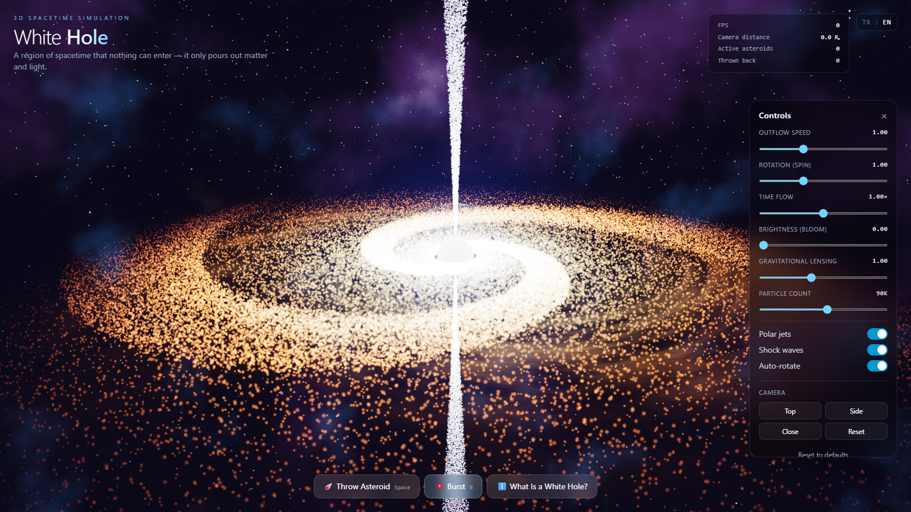
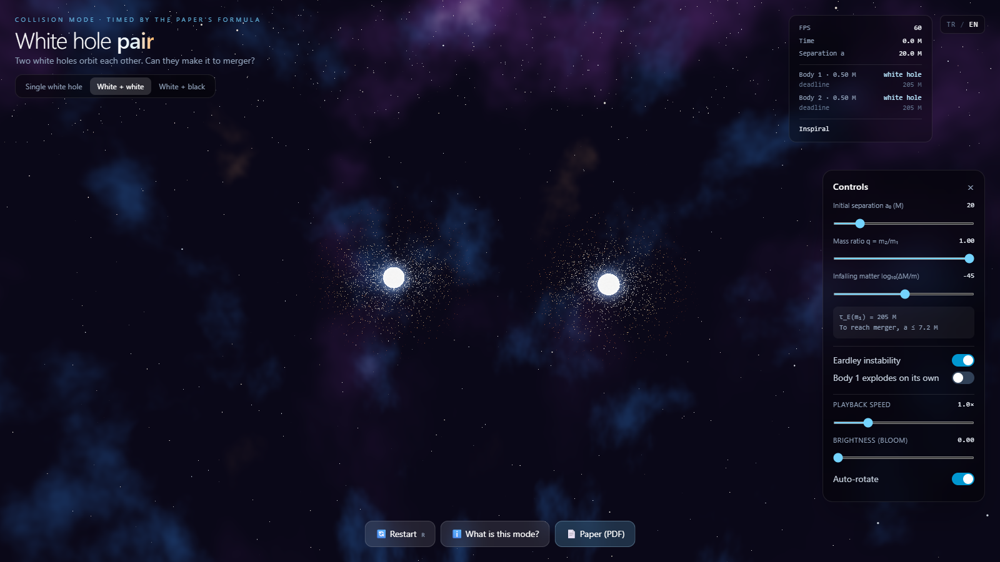
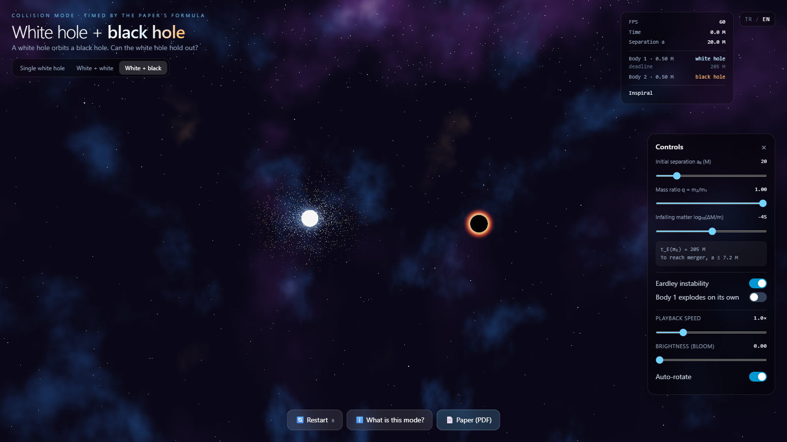

# Can White Holes Merge? · Paper and 3D Simulation

A white hole is a black hole run backwards in time: nothing can get in, matter and light only pour out. This repository holds a short paper on what happens when two white holes, or a white hole and a black hole, meet in a binary, and an interactive 3D simulation that goes with it. The simulation runs in the browser and is built with React, TypeScript, three.js, Vite and Tailwind. English and Turkish (TR | EN toggle in the header).

**Paper:** [paper/white-hole-binaries.pdf](paper/white-hole-binaries.pdf)
**Live simulation:** https://pandakingpunc.github.io/white-hole-simulation/



## The paper

*Can white holes merge? Eardley lifetimes from exact null-shell crossing and their consequences for white-hole binaries* (M. Karatüm, 2026).

White holes are unstable: matter falling towards one piles up outside the horizon and seals it into a black hole (Eardley 1974). Using the exact null-shell model of Barceló, Carballo-Rubio and Garay (JHEP 2016), the paper:

- writes the lifetime of a white hole of mass *M* hit by a perturbation *ΔM* in closed form, **τ_E = 4M [ln(M/ΔM) − 1 − ΔM/M]** (G = c = 1);
- shows that the energy of a late explosion falls off universally as 1 − e^((Δt − τ_E)/4M), whatever *ΔM* is;
- finds τ_E ≈ 250–880 *M* for every astrophysical mass from 10 M☉ to 6.5 × 10⁹ M☉, from a single quantum the size of the hole up to the cosmic microwave background;
- compares this with gravitational-wave inspiral: a white hole can only reach merger if it is first exposed at a separation of about 10 *M* or less, roughly one orbit before plunge;
- shows that when one white hole of a pair explodes, its debris seals the partner within tens of its own mass units;
- concludes, with the time-reversed area theorem, that white holes in binaries either explode before merging or merge as black holes.

The estimates rest on spherical symmetry and null shells, and the paper lists these limits. Every number, table and figure is produced by [`paper/compute.py`](paper/compute.py), which also checks the threshold condition, the DTR identity and the universal profile against the exact expressions:

```bash
cd paper
python compute.py
pdflatex white-hole-binaries.tex
```

## Collision modes

| White + white | White + black |
| --- | --- |
|  |  |

Two bodies orbit and spiral in. Each white hole has a deadline from the paper's formula. When it runs out, the white hole is sealed into a black hole. Body 1 can also be set to explode on its own earlier, and then its debris shortens its partner's deadline (the domino effect). Two black holes merge with a gravitational-wave ripple. Switch off Eardley's instability to see hypothetical stable white holes: the run stops when a white-hole horizon touches another horizon, because no solution is known for that. Only the explosion and sealing times come from the paper. The orbit is a Newtonian circle shrinking at the Peters rate, and the visuals are illustrative. Open a mode directly with `?mode=wh-wh` or `?mode=wh-bh`.

## Single white hole: what you can do

- **Throw asteroids** (Space): gravity pulls them in, the outflow heats them up and throws them back before they ever reach the horizon.
- **Trigger a burst** (B): a sudden release of matter and energy with expanding shock shells.
- **Tune the scene:** outflow speed, rotation (spin), time flow, brightness (bloom), gravitational lensing strength and particle count (10K–160K).
- **Toggle** polar jets, periodic shock waves and auto-rotation.
- **Camera presets:** top, side and close-up views, or orbit freely with the mouse.
- **Read the info panel** for a short explanation of white holes and how they differ from black holes.

## What is on screen

- **The glowing centre** stands for the past event horizon, the surface nothing can cross from outside.
- **The matter disk** streams outwards in spiral arms and cools as it goes, from blue-white through yellow to deep red.
- **Polar jets** carry matter out along the spin axis.
- **Shock waves** leave the centre at regular intervals.
- **Gravitational lensing** bends the background stars and nebulae around the centre (a screen-space approximation).

### Simplifications

- This is a visual interpretation, not a general-relativity solver. Particle orbits, the outflow and the lensing are stylised.
- Asteroids feel a Newtonian 1/r² pull plus an outward pressure from the flow, which is what stops them at the horizon.
- No white hole has ever been observed. They are allowed by the mathematics of general relativity but are not known to exist.

For a physically traced black hole, see the companion project [Kerr Black Hole](https://github.com/pandakingpunc/kerr-black-hole), a real-time GR ray tracer.

## Fixes over the first version

The first version was generated with Claude Opus 5.5 (high effort) on arena.ai. It was then reviewed, tested and fixed with [Claude Code](https://claude.com/claude-code):

- **Brightness washed out the whole frame.** The default bloom was 1.25 and anything above about 0.3 turned the screen white, because the additive particle disk is far brighter than 1.0 in HDR. Bloom now starts at 0 and the slider is mapped onto the usable range.
- **Black hole mode removed.** The time-reversed mode duplicated what Kerr Black Hole already does, and did it less well.
- **Asteroids split into shards up close.** Each corner of the rock was scaled separately, so its faces came apart. Corners are now shared, and the rocks are lit by the white hole.
- **Mobile:** the control panel covered most of the scene and overlapped the buttons. It now starts closed on phones, and portrait screens get a wider field of view.
- **Smaller fixes:** burst follow-up shells now run on simulation time (they paused with time flow and could fire after the scene was torn down), zero-size framebuffer errors on the first frame, deprecated `THREE.Clock`, missing material and texture cleanup, Escape now closes the info panel.
- **English** was added next to Turkish.

## Run

```bash
npm install
npm run dev
```

To build:

```bash
npm run build
```

This produces a single self-contained `dist/index.html` that you can open directly in a browser.

## Controls

| Input | Action |
| --- | --- |
| Drag / scroll / right-drag | Orbit / zoom / pan |
| Space | Throw an asteroid |
| B | Burst |
| H | Show / hide the control panel |
| Esc | Close the info panel |
| R | Restart a collision run |

Add `?lang=tr` or `?lang=en` to the URL to open in a given language. Otherwise the browser language decides, and the choice is remembered.

## Türkçe

Beyaz delik, zamanda geriye oynatılan bir kara deliktir: içine hiçbir şey giremez, yalnızca madde ve ışık fışkırır. Bu proje o fikrin tarayıcıda çalışan interaktif 3D bir yorumu. Dışarı doğru sarmallanan madde diskini izleyebilir, ufka asteroit fırlatıp akkor halinde geri savrulmasını görebilir ya da bir patlama başlatabilirsin. Arayüz Türkçe ve İngilizce; sağ üstteki TR | EN düğmesiyle dil değişir, seçimin tarayıcıda hatırlanır. Tuşlar: Boşluk asteroit fırlatır, B patlama, H paneli gizler.

Depoda ayrıca bir makale var: *Can white holes merge?* Beyaz deliğin üstüne düşen madde yüzünden kara deliğe çökme süresini kesin bir formülle hesaplıyor (τ_E = 4M[ln(M/ΔM) − 1 − ΔM/M]) ve bunu ikili sistemlerin birleşme süresiyle karşılaştırıyor. Sonuç: beyaz delikler ya birleşmeden patlar ya da kara delik olarak birleşir. Simülasyondaki "Beyaz + beyaz" ve "Beyaz + kara" modları bu süreyi kullanıyor.

## Author

Mustafa Karatüm · ORCID [0009-0006-7053-2872](https://orcid.org/0009-0006-7053-2872)

## Citation

Citation metadata for the paper and the simulation is in [CITATION.cff](CITATION.cff) (GitHub shows a "Cite this repository" button).

## License

[MIT](LICENSE) © 2026 Mustafa Karatüm
